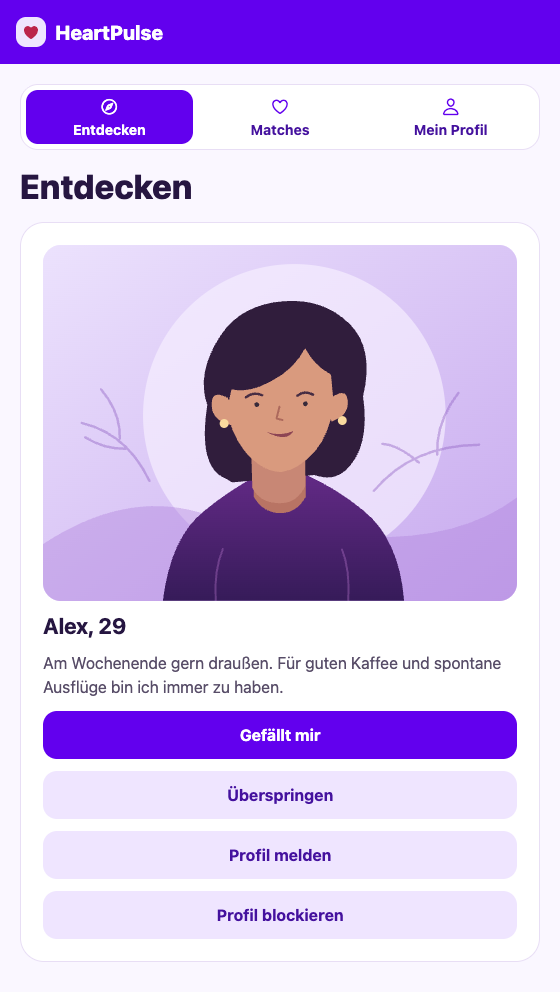
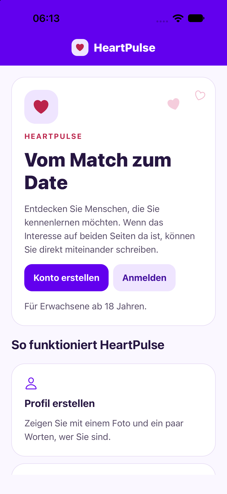

# HeartPulse

**A dating app for web, Android, and iOS with mutual matches and private chats.**

[Open the web app](https://heartpulse.onrender.com) · [Deutsch](README.md)

## Live web app

[](https://heartpulse.onrender.com)

*Screenshot of the web app with a fictional sample profile.*

## iOS app

<a href="docs/heartpulse-ios.png"></a>

*Native iOS app running in the iPhone Simulator.*

[Run the iOS app locally with Xcode](docs/ios.md#ios-simulator-en)

## Features

- Discover profiles, express interest, and match when the interest is mutual
- Chat privately with matches
- Manage your profile and photo, and block or report other accounts
- Verify your email, reset your password, and delete your account

## Collaborative project

**Pacome Adoufack Tsamo** developed and designed HeartPulse. Pacome and I worked together on HeartPulse.

[](https://github.com/Pacome-Adoufack)
[](https://www.linkedin.com/in/pacome-adoufack-tsamo-8a2972317/)

## Stack

| Area | Stack |
| --- | --- |
| Frontend | React Native, Expo, and Expo Router |
| Backend | Node.js and PostgreSQL |
| Hosting and services | Render, Neon, Cloudinary, and Resend |

## Run locally

Use Node.js 24.3 or later within the 24.x series, and npm. Local development uses embedded PostgreSQL and does not require production credentials.

```sh
cd DatingApp
npm ci
EXPO_PUBLIC_LIVE_ENABLED=true npm run build:web
cd ../server
npm ci
HEARTPULSE_WEB_DIR=../DatingApp/dist npm start
```

Open [localhost:3407](http://127.0.0.1:3407). Run the tests from the repository root:

```sh
(cd DatingApp && npm test)
(cd server && npm test)
```

[Technical documentation for hosting and operations](docs/hosting.md)

## Author

Michael Koch
