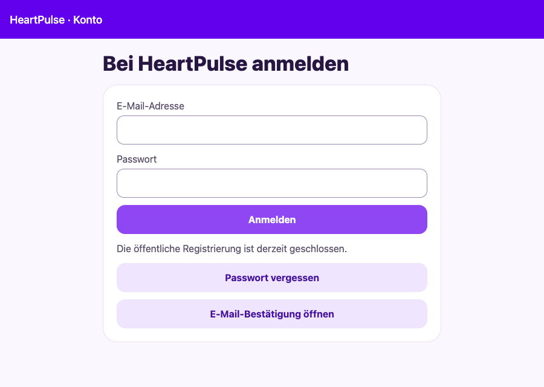

# HeartPulse

[HeartPulse öffnen](https://heartpulse.onrender.com) · [English](README.en.md) · [GitHub](https://github.com/michkffm/Dating-App-IOS-Android)

HeartPulse ist eine Dating-App für iOS, Android und Web. Sie verbindet ein Expo-Frontend mit einer Node.js-API und PostgreSQL. Dazu gehören Registrierung und Anmeldung, Profile, Likes, gegenseitige Matches, Chat und Kontolöschung. Nutzende können Profile melden oder sperren. Fotos werden über einen serverseitigen Cloudinary-Adapter verarbeitet.

## Live-Web-App

[](https://heartpulse.onrender.com)

Die Anmeldeseite ist öffentlich erreichbar. Die Registrierung neuer Konten ist derzeit geschlossen.

## Gemeinschaftsprojekt

**Pacome Adoufack Tsamo** hat HeartPulse entwickelt und gestaltet. Pacome und ich haben gemeinsam an HeartPulse gearbeitet.

[](https://github.com/Pacome-Adoufack)
[](https://www.linkedin.com/in/pacome-adoufack-tsamo-8a2972317/)

## Voraussetzungen

- Node.js 24.3 oder neuer innerhalb der 24er-Reihe und npm
- Für native Installationen: ein mit dem Expo SDK kompatibler Development Build
- Für eine Einrichtung außerhalb des Macs: PostgreSQL und ein eigener Cloudinary-Zugang eingerichtet über den Secret Store des Hosters

## Lokal entwickeln

```sh
cd DatingApp
npm ci
EXPO_PUBLIC_LIVE_ENABLED=true npm run build:web
cd ../server
npm ci
HEARTPULSE_WEB_DIR=../DatingApp/dist npm start
```

Die App ist unter `http://127.0.0.1:3407` erreichbar. Lokal nutzt der Server eingebettetes PostgreSQL (PGlite) und speichert Daten außerhalb von Git. Für die Entwicklung bitte ausschließlich fiktive Konten anlegen. Web und API laufen lokal unter derselben Adresse. Für native Entwicklung greifen die Apps über eine konfigurierte API-Adresse in `EXPO_PUBLIC_API_ORIGIN` zu. Der Modus mit Beispielprofilen bleibt für Offline-Tests verfügbar.

## Tests

```sh
(cd DatingApp && npm test)
(cd server && npm test)
```

Die API-Tests prüfen Anmeldung, Session-Schutz, gegenseitige Matches, Zugriff auf Chat und Fotos, Blockieren, Melden, Löschung und Persistenz. Die Medien-Tests prüfen die Dekodierung, Größenbegrenzung und Entfernung von Metadaten.

## Technische Dokumentation

[Hosting, Datenschutz und Betrieb](docs/hosting.md)

## Autor

Michael Koch
