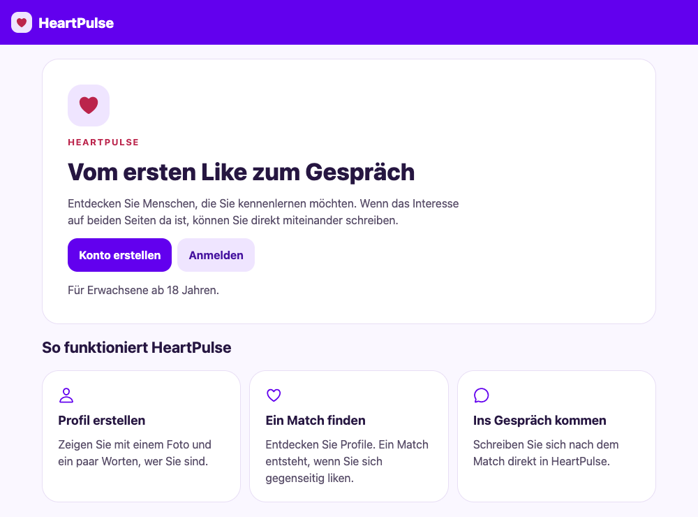

# HeartPulse

**Eine Dating-App mit gegenseitigen Matches und privaten Chats.**

[Web-App öffnen](https://heartpulse.onrender.com) · [English](README.en.md)

## Live-Web-App

[](https://heartpulse.onrender.com)

## Funktionen

- Profile entdecken, Interesse zeigen und bei gegenseitigem Interesse ein Match erhalten
- Innerhalb eines Matches privat chatten
- Profil und Foto verwalten, andere Konten blockieren oder melden
- E-Mail-Adresse bestätigen, Passwort zurücksetzen und das eigene Konto löschen

## Gemeinschaftsprojekt

**Pacome Adoufack Tsamo** hat HeartPulse entwickelt und gestaltet. Pacome und ich haben gemeinsam an HeartPulse gearbeitet.

[](https://github.com/Pacome-Adoufack)
[](https://www.linkedin.com/in/pacome-adoufack-tsamo-8a2972317/)

## Technik

| Bereich | Stack |
| --- | --- |
| Oberfläche | React Native, Expo und Expo Router |
| Backend | Node.js und PostgreSQL |
| Hosting und Dienste | Render, Neon, Cloudinary und Resend |

## Lokal starten

Voraussetzung: Node.js 24.3 oder neuer innerhalb der 24er-Reihe und npm. Die lokale Umgebung verwendet eingebettetes PostgreSQL und benötigt keine produktiven Schlüssel.

```sh
cd DatingApp
npm ci
EXPO_PUBLIC_LIVE_ENABLED=true npm run build:web
cd ../server
npm ci
HEARTPULSE_WEB_DIR=../DatingApp/dist npm start
```

Die Web-App ist dann unter [localhost:3407](http://127.0.0.1:3407) erreichbar. Die Tests starten im Repository-Hauptordner:

```sh
(cd DatingApp && npm test)
(cd server && npm test)
```

[Technische Dokumentation für Hosting und Betrieb](docs/hosting.md)

## Autor

Michael Koch
